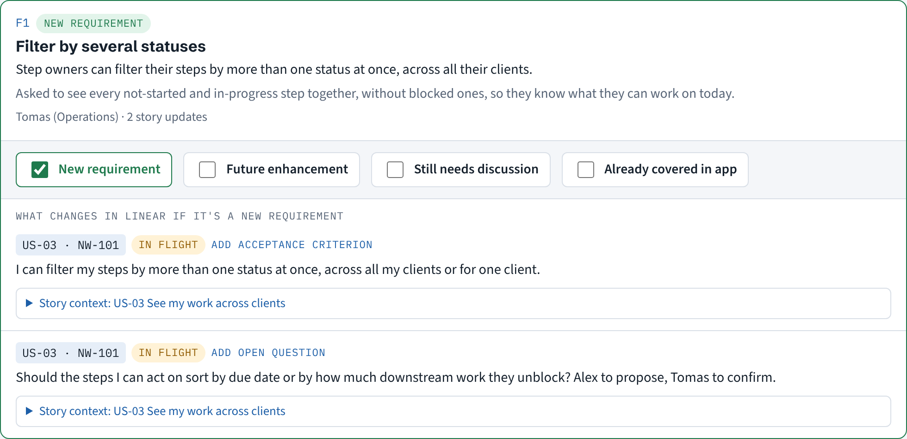

# feedback-review

Turn a weekly user feedback session into approved user-story updates, with one decision per piece of feedback.

You run a recurring session where users see the product and react: a focus group, a demo review, a UAT check-in. Granola records it. The next step is always the same chore: work out what people said, decide what to act on, check it with the devs, and update the stories. This plugin does the legwork and leaves you the decisions.



## How it works

1. **After the session**, a scheduled Claude task reads the Granola note and transcript, pulls out each piece of feedback, and maps it to the user stories in Linear it would change. It publishes a private review page and DMs you the link.
2. **You classify each piece of feedback** on the page:
   - **New requirement:** the story updates under the card go into Linear once the devs approve. A new story gets created if nothing existing fits.
   - **Future enhancement:** one ticket in your Future Enhancements milestone, linked to the stories it would touch.
   - **Still needs discussion:** you're still working through the requirements. Nothing changes in Linear.
   - **Already covered in app:** nothing changes in Linear; Slack says what already covers it.
3. **Send for dev approval.** The page posts to your project channel with all four groups and asks your devs to approve the new requirements only.
4. **Apply.** Once they approve, one button updates the stories in Linear, comments on each one, and replies in the thread.

Nothing reaches your team or Linear until you press a button on the page.

## What you need

- **Claude** with Cowork or Claude Code, artifacts that can use connectors, and scheduled tasks.
- **Granola** connected to Claude. A paid plan lets the workflow read one folder; otherwise it matches meetings by title.
- **Linear** connected to Claude. Your user stories are issues in one project, with titles that share a prefix like `US-`.
- **Slack** connected to Claude, for the approval thread and your DM.

Other project tools are on the [roadmap](ROADMAP.md).

## Install

Tell your Claude agent:

> Set up the feedback review from github.com/itskstevens/feedback-review

Your agent follows [SETUP.md](SETUP.md): it installs the plugin, checks your connectors, asks about six questions, creates the Linear milestone it needs, saves your settings, schedules the weekly run, and does a dry run on your latest session that only messages you.

To install the plugin by hand in Claude Code:

```
/plugin marketplace add itskstevens/feedback-review
/plugin install feedback-review@itskstevens
```

then ask Claude to "set up the feedback review".

## What's in here

| Path | What it is |
|---|---|
| `skills/feedback-review/` | The weekly run: read the session, map feedback to stories, build and publish the page |
| `skills/feedback-review/assets/review-page.html` | The review page template |
| `skills/feedback-review/scripts/build_page.py` | Validates the data and builds the page (standard library only) |
| `skills/feedback-review-setup/` | Guided setup and the scheduled task prompt |
| `config.example.yaml` | Every setting, with comments |
| `examples/` | Made-up data for a fictional team, and the page it builds |
| `docs/` | Linear notes and the spec a new project tool has to meet |
| `tests/` | Data validation tests and a browser test with Linear and Slack mocked |

## Privacy

The repo holds no meeting content. Your settings, generated data and review pages stay in your own Claude project and artifacts. Review pages are private to you until you share them.

## Develop

```
npm install
npx playwright install chromium
npm test
```

## License

MIT. Maintained by [Kevin Stevens](https://github.com/itskstevens). Issues and pull requests welcome.
