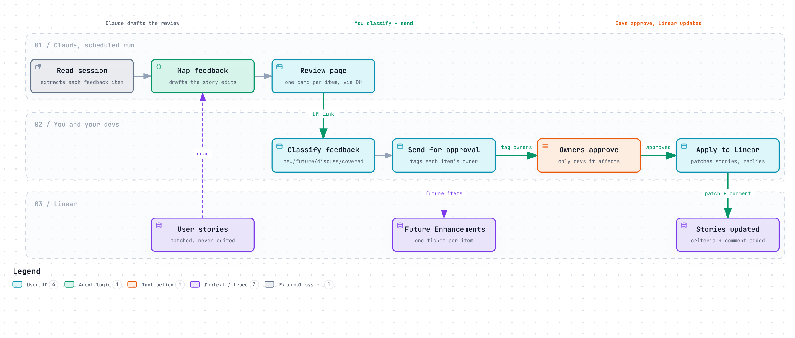

<p align="center">
  <picture>
    <source media="(prefers-color-scheme: dark)" srcset="docs/logo-dark.svg">
    
  </picture>
</p>

<h3 align="center">Turn last week's user feedback session into approved user-story updates.<br>One decision per piece of feedback.</h3>

<p align="center">
  <a href="LICENSE"></a>
  <a href=".claude-plugin/plugin.json"></a>
  <a href="https://github.com/itskstevens/feedback-review/actions/workflows/test.yml"></a>
  
  
</p>

<p align="center">
  <b><a href="#-install">Install</a> · <a href="#-how-it-works">How it works</a> · <a href="#-the-four-boxes">The four boxes</a> · <a href="ROADMAP.md">Roadmap</a></b>
</p>

<p align="center">
  
</p>

---

You run a recurring session where users see the product and react: a focus group, a demo review, a UAT check-in. Granola records it. Then comes the same chore every week: work out what people said, decide what to act on, check it with the devs, update the stories.

**feedback-review does the legwork and leaves you the decisions.** A scheduled Claude run reads the session, maps each piece of feedback to the Linear stories it would change, and hands you a review page. You tick one box per card. The page handles Slack and Linear.

## ⚡ Install

Tell your Claude agent:

```text
Set up the feedback review from github.com/itskstevens/feedback-review
```

It follows [SETUP.md](SETUP.md): installs the plugin, checks your connectors, asks a few questions, and **works out with you who owns which part of the build**, testing the map on your real stories until you confirm it. Then it creates the Linear milestone it needs, schedules the weekly run, and does a dry run on your latest session that only messages you.

<details>
<summary><b>Install by hand in Claude Code</b></summary>

```text
/plugin marketplace add itskstevens/feedback-review
/plugin install feedback-review@itskstevens
```

Then ask Claude to "set up the feedback review".

</details>

### What you need

| | |
|---|---|
| **Claude** | Cowork or Claude Code, with artifacts that can use connectors, and scheduled tasks |
| **Granola** | Connected to Claude. A paid plan lets the run read one folder; otherwise it matches meetings by title |
| **Linear** | Connected to Claude. User stories live in one project and share a title prefix like `US-` |
| **Slack** | Connected to Claude, for the approval thread and your DM |

## 🧭 How it works

<p align="center">
  <picture>
    <source media="(prefers-color-scheme: dark)" srcset="docs/flow-dark.png">
    
  </picture>
</p>

<p align="center"><sub>Drawn with <a href="https://github.com/tt-a1i/archify">Archify</a>. Download <a href="docs/flow.html">docs/flow.html</a> for the interactive version.</sub></p>

1. **Claude drafts the review for you.** After the session, the scheduled run reads the Granola note and transcript, pulls out each piece of feedback, and drafts the story edits each one would need. You get a DM with a link to a private review page.
2. **You make one call per piece of feedback, not per story edit.** Tick one of the four boxes on each card. The page won't send until every card has one.
3. **Only the devs it affects get tagged.** Every piece of feedback is matched to the dev who owns that part of the build. Sending logs future enhancements in Linear and posts one Slack thread; each owner is tagged only on the new requirements that touch their part, and approves just those.
4. **Linear updates in one click after approval.** The page patches each approved story, leaves a comment saying what changed and who approved it, creates any new stories, and replies in the thread.

### What your devs see

```text
Who needs to look at what
@Alex: 1, 3 (the tracker app, plus its hosting)
@Jordan: 2 (data and integrations)
Nothing for Sam this week.

1. Filter by several statuses · Alex
   Step owners can filter their steps by more than one status at once.
   Stories: NW-101 US-03 See my work across clients
```

## 🗳 The four boxes

| | Box | In Linear | In Slack |
|---|---|---|---|
| 🟢 | **New requirement** | Story updates go in after dev approval. A new story is created if nothing fits | Listed for approval |
| 🟣 | **Future enhancement** | One ticket in your Future Enhancements milestone, linked to the stories | Listed, no action needed |
| 🟠 | **Still needs discussion** | Nothing yet | Listed, no action yet |
| 🔵 | **Already covered in app** | Nothing | Listed with what covers it |

## 🔒 Safe by default

- The scheduled run only reads. It writes nothing to Linear and messages only you.
- Devs are tagged only on feedback that touches their part of the build, and you can change the owner on any card before sending.
- Nothing reaches your team or Linear until you press a button on the page.
- The page re-reads each story before patching and skips anything whose wording changed.
- This repo holds no meeting content. Your settings and pages stay in your own Claude project and artifacts.

<details>
<summary><b>What's in the repo</b></summary>

| Path | What it is |
|---|---|
| `skills/feedback-review/` | The weekly run: read the session, map feedback, build and publish the page |
| `skills/feedback-review/assets/review-page.html` | The review page template |
| `skills/feedback-review/scripts/build_page.py` | Validates the data and builds the page (standard library only) |
| `skills/feedback-review-setup/` | Guided setup and the scheduled task prompt |
| `config.example.yaml` | Every setting, with comments |
| `examples/` | Made-up data for a fictional team, and the page it builds |
| `docs/` | Linear notes, the adapter spec for other tools, and the flow diagram |
| `tests/` | Data validation tests and a browser test with Linear and Slack mocked |

</details>

## 🛣 Roadmap

Linear is the MVP. GitHub Issues, Asana, Jira, other note takers, Microsoft Teams and more are in [ROADMAP.md](ROADMAP.md). Vote or propose in [issues](https://github.com/itskstevens/feedback-review/issues).

## 🧪 Develop

```bash
npm install
npx playwright install chromium
npm test
```

---

<p align="center">
  <sub>MIT · Maintained by <a href="https://github.com/itskstevens">@itskstevens</a> · Issues and pull requests welcome</sub>
</p>
